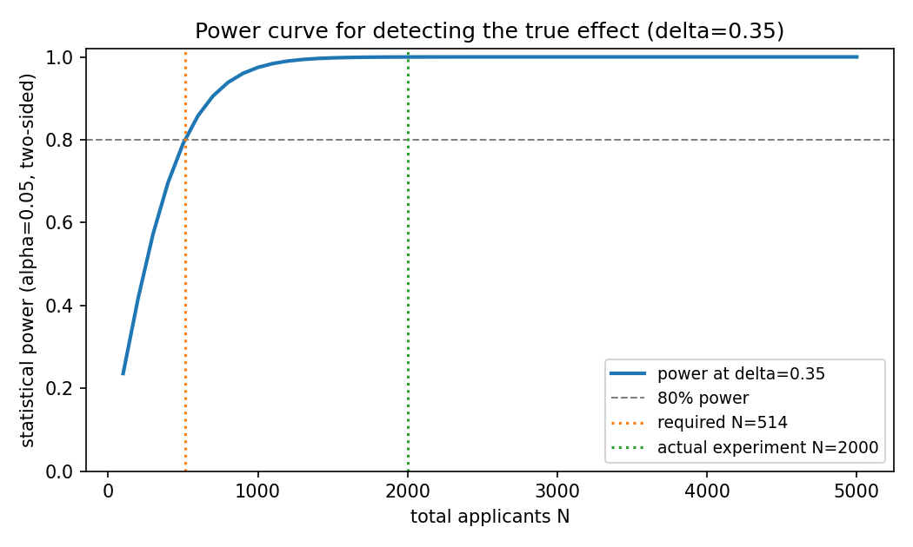

# Hiring-experiment analysis report

> **Disclaimer:** this is a *methodology demonstration* on fully synthetic, simulated data. It is not legal advice, not HR advice, and not evidence about any real hiring process. Nothing here should be used to make real hiring decisions.

All numbers below are computed by `src/make_report.py` from synthetic data
generated with fixed seeds (`src/data_gen.py`). The **known true treatment
effect** baked into both datasets is **tau = +0.35** (standardized units:
+0.35 SD of the residual outcome noise). The experiment tests a hypothetical
"new structured interview rubric vs. old unstructured interviews" on a
hypothetical 90-day new-hire performance score.

## 1. Randomized experiment (N = 2000)

- Randomization: 50/50, `980` control / `1020` treatment.
- Observed means: control -0.015, treatment 0.291.
- Pre-experiment covariate `assessment_score` correlates with the outcome
  (outcome-model R^2 = 0.523), which is what makes CUPED work.

| Estimator | ATE | SE | 95% CI | p-value |
|---|---|---|---|---|
| Difference-in-means (Welch t) | 0.3054 | 0.0627 | [0.1825, 0.4283] | 1.19e-06 |
| CUPED (covariate-adjusted) | 0.3890 | 0.0435 | [0.3037, 0.4743] | 8.62e-19 |
| OLS / ANCOVA | 0.3897 | 0.0436 | [0.3043, 0.4751] | — |

**Variance reduction.** CUPED estimated theta = 0.9971 and reduced
the sampling variance of the ATE estimator by **51.8%**
relative to raw difference-in-means (CI width shrank accordingly).

**Coverage.** The raw 95% CI covers the true tau = 0.35; the CUPED 95% CI
covers it. (A 95% CI is *expected* to miss the truth ~5% of the time —
this run got lucky/unlucky accordingly; what matters is the procedure, not the
single draw.)

## 2. Power analysis

The unadjusted outcome has within-arm variance 2 (covariate variance 1 plus
noise variance 1). The default calculations below therefore use sigma=sqrt(2).
An ideal covariate-adjusted design uses residual sigma=1 and requires
129 per arm under this known DGP.
This is a planning approximation, not a universal CUPED sample-size guarantee.

Minimum detectable effect (MDE) and power at several effect sizes
(alpha = 0.05 two-sided, sigma = sqrt(2), unadjusted outcome SD):

| total N | per arm | MDE | power d=0.20 | power d=0.30 | power d=0.35 | power d=0.50 |
|---|---|---|---|---|---|---|
| 200 | 100 | 0.560 | 0.170 | 0.323 | 0.417 | 0.705 |
| 500 | 250 | 0.354 | 0.353 | 0.660 | 0.790 | 0.977 |
| 1000 | 500 | 0.251 | 0.609 | 0.918 | 0.975 | 1.000 |
| 2000 | 1000 | 0.177 | 0.885 | 0.997 | 1.000 | 1.000 |
| 4000 | 2000 | 0.125 | 0.994 | 1.000 | 1.000 | 1.000 |

- To detect the true effect delta = 0.35 at 80% power: **257 per arm
  (514 total)**.
- With the actual N = 2000 (980 control / 1020
  treatment realized): MDE = 0.177,
  power at delta = 0.35 is 0.9998 — the experiment is heavily
  over-powered for the true effect, which is why all CIs above are tight.



## 3. Observational (non-randomized) data — causal estimates (N = 2000)

Confounding: the new rubric was piloted first with stronger-assessed
candidates — mean `assessment_score` is 0.381 among treated vs
-0.457 among controls. Estimated propensity model:
logit(e) = 0.218 + 0.988 * assessment_score.

| Estimator | ATE | 95% bootstrap CI |
|---|---|---|
| Naive difference-in-means | 1.1416 | [1.0229, 1.2675] |
| IPW (Hajek, estimated propensity) | 0.3285 | [0.2094, 0.4465] |
| Outcome regression (OLS adj.) | 0.3151 | [0.2126, 0.4148] |
| Doubly robust | 0.3064 | [0.1985, 0.4118] |

True tau = 0.35. The naive estimate is biased upward by **+0.7916** —
it mistakes the treated group's pre-existing assessment advantage for a rubric
effect. IPW removes most of that bias (|error| = 0.0215) and the doubly
robust estimator has |error| = 0.0436. In this particular draw,
the smaller absolute error identifies the closer estimate; no estimator is
guaranteed to be closest in every finite sample.

**The unconfoundedness assumption.** These corrections are only valid if,
conditional on `assessment_score`, rubric assignment was as good as random.
That can fail: if, say, enthusiastic managers both volunteered for the pilot
*and* coached their new hires harder, an unmeasured confounder remains and
even the adjusted estimates stay biased. With real (non-synthetic) data there
is no way to verify this from the data alone — which is why randomized
experiments (Section 1) are the gold standard.

## 4. Reproducibility

```
pip install -r requirements.txt
python -m src.make_report   # regenerates this file + the figure
pytest tests/               # determinism, variance-reduction, coverage checks
```

Seeds: experiment = 20260922, observational = 424242, bootstrap = 777.
